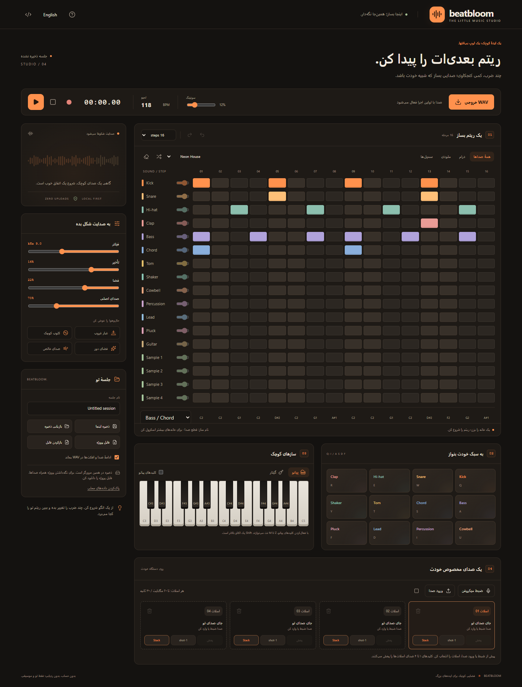

<div align="center">


**استودیوی موسیقی خصوصی و ساده؛ همین‌جا در مرورگر.**

[](https://github.com/maboox/BeatBloom/actions/workflows/ci.yml)
[](LICENSE)

### [▶ ورود به استودیو](https://maboox.github.io/BeatBloom/) · [↓ نسخه‌ها](https://github.com/maboox/BeatBloom/releases) · [English](README.md)

بدون حساب کاربری، بدون ردیابی، بدون ارسال صدای تو.

</div>



BeatBloom یک استودیوی کوچک برای ثبت ایده‌های موسیقی است: ریتم بساز، ملودی بنواز، صدایت را ضبط کن و لوپ را همراه خودت ببر. سازها، سمپل‌ها و افکت‌ها در پخش زنده و خروجی WAV از یک موتور مشترک Web Audio استفاده می‌کنند.

## اولین لوپ تو

۱. [استودیو را باز کن](https://maboox.github.io/BeatBloom/) و با دکمهٔ «فارسی» زبان را تغییر بده.

۲. یک الگو انتخاب کن و پخش را بزن؛ با تغییر خانه‌ها ریتم را شخصی کن.

۳. با پدها، پیانو یا گیتار بنواز. دکمهٔ ضبط الگو، ضرب‌های اجراشده را در مرحلهٔ در حال شنیدن ثبت می‌کند.

۴. یک اسلات سمپل انتخاب کن؛ سپس صدا وارد کن یا میکروفن را ضبط کن.

۵. برای فایل صوتی «خروجی WAV» و برای نسخهٔ قابل ویرایش همراه همهٔ صداها «فایل پروژه» را بزن.

میکروفن به HTTPS یا localhost و اجازهٔ مرورگر نیاز دارد.

## امکانات

| ساختن                                     | شکل‌دادن                                      | نگه‌داشتن                                |
| ----------------------------------------- | --------------------------------------------- | ---------------------------------------- |
| ۱۷ ردیف و لوپ‌های ۸، ۱۶، ۲۴ و ۳۲ مرحله‌ای | قطع صدا و حجم مستقل هر ردیف                   | ذخیره و بازیابی در همین مرورگر           |
| ۱۰ الگوی قابل ویرایش                      | فیلتر، تأخیر، ریورب و صدای اصلی               | فایل `.beatbloom` شامل همهٔ سمپل‌ها      |
| ۱۲ پد اجرای زنده                          | تمپو و سوئینگ قابل تنظیم                      | WAV استریو، ۴۴٫۱ کیلوهرتز، ۱۶ بیت        |
| پیانوی دو اکتاو و گیتار شش‌سیم            | چهار اسلات تک‌ضرب یا لوپ با حالت Stack / Mono | خروجی با ادامهٔ صداها یا لوپ با طول دقیق |
| ضبط داخل الگو و بازگشت/تکرار تغییرات      | رابط فارسی و انگلیسی                          | چیدمان سازگار با موبایل                  |

محدودیت هر سمپل: **۲۰ مگابایت، ۳۰ ثانیه، مونو یا استریو**. فرمت صوتی قابل ورود به مرورگر بستگی دارد. فایل‌های JSON نسخه‌های ۱ تا ۳٫۱ هم پذیرفته می‌شوند؛ چون صدا در آن فایل‌های قدیمی نبود، از اسلات‌های موجود همین مرورگر استفاده می‌کنند.

## میان‌برها

| کار                    | کلید                                                      |
| ---------------------- | --------------------------------------------------------- |
| پخش / مکث              | `Space` خارج از ورودی‌ها و دکمه‌ها                        |
| درام و سازهای کوبه‌ای  | `Q W E R T Y U I`                                         |
| بیس، آکورد، لید و پلاک | `A S D F`                                                 |
| پیانو                  | «کلیدهای پیانو» را فعال کن؛ سپس `Z S X D C V G B H N J M` |
| اکتاو بالاتر           | `Shift` همراه کلیدهای پیانو                               |
| سمپل‌ها                | `1 2 3 4`                                                 |
| بازگشت / تکرار         | `Ctrl/⌘ Z` و `Ctrl/⌘ Shift Z`                             |
| ذخیرهٔ محلی            | `Ctrl/⌘ S`                                                |

در حالت پیانو، میان‌بر پدها غیرفعال می‌شود تا هر کلید فقط یک ساز را بنوازد. انتخابگر زیر جدول برای ویرایش نت‌های بیس/آکورد، لید، پلاک و گیتار است. ضبط پیانو، نت نواخته‌شده را حفظ می‌کند. کوتاه‌کردن لوپ، مرحله‌های مخفی را نگه می‌دارد تا بعداً دوباره طول را زیاد کنی. الگوها، خانه‌ها و تمپو را تغییر می‌دهند؛ بازگشت، وضعیت قبلی را برمی‌گرداند.

## حریم خصوصی و ذخیره‌سازی

- پردازش صدا روی دستگاه انجام می‌شود. برنامه سرور پردازش، آمارگیر، فونت خارجی یا وابستگی به CDN در زمان اجرا ندارد.
- «ذخیره اینجا»، تنظیمات و الگو را در localStorage ذخیره می‌کند. فایل‌های صوتی در IndexedDB همان نشانی و پروفایل مرورگر می‌مانند. اسلات‌ها بین جلسه‌های محلی مشترک‌اند.
- «فایل پروژه» همهٔ صداها را همراه خود دارد. قبل از پاک‌کردن داده‌های مرورگر، تغییر میزبان یا جایگزین‌کردن سمپل‌ها از این فایل پشتیبان بگیر. آن را فقط با کسانی به اشتراک بگذار که می‌خواهی ضبط‌هایت را بشنوند.
- «پاک‌کردن داده‌های محلی»، جلسهٔ ذخیره‌شده و سمپل‌ها را حذف می‌کند. الگوی فعلی تا بستن صفحه در حافظه باقی می‌ماند.
- میکروفن با پایان ضبط، خطا، رسیدن به محدودیت یا مخفی‌شدن صفحه قطع می‌شود. پخش هم در تب مخفی متوقف می‌شود.

میزبان عمومی GitHub Pages درخواست‌های معمول صفحه و فایل‌های برنامه را دریافت می‌کند؛ صدای ضبط‌شده و محتوای پروژه برایش ارسال نمی‌شود. افزونه‌های مرورگر و امنیت خود دستگاه خارج از کنترل برنامه‌اند. جزئیات در [سیاست امنیت](SECURITY.md).

## اجرا و توسعهٔ محلی

**Node.js 24 LTS** پیشنهاد می‌شود؛ حداقل نسخه ۲۲٫۱۳ است.

```sh
git clone https://github.com/maboox/BeatBloom.git
cd BeatBloom
npm ci --ignore-scripts
npm run dev
```

نشانی localhost نمایش‌داده‌شده را باز کن. پس از نصب وابستگی‌ها، در ویندوز `run-local.bat` و در مک و لینوکس `sh run-local.sh` هم همین کار را انجام می‌دهند.

```sh
npm run check
npx playwright install chromium
npm run test:e2e
npm run test:production
npm run preview
```

دستور اول، بررسی کد، قالب‌بندی، آزمون واحد و ساخت خروجی انتشار را انجام می‌دهد. آزمون‌های مرورگر، عملکرد، ورود فایل، صدا و دسترس‌پذیری را بررسی می‌کنند. برای استفاده از Edge نصب‌شده در پاورشل، پیش از آزمون `$env:PLAYWRIGHT_CHANNEL='msedge'` را تنظیم کن.

## انتشار و ساختار پروژه

`npm run build` پوشهٔ `dist/` را می‌سازد. آن را روی یک میزبان استاتیک HTTPS قرار بده؛ در اجرا به نصب بسته‌ها نیازی نیست. بازکردن مستقیم `index.html` با `file://` در این نسخه پشتیبانی نمی‌شود.

GitHub Actions پیش از انتشار شاخهٔ اصلی، آزمون‌ها را اجرا می‌کند. نسخهٔ اکشن‌ها به شناسهٔ دقیق کامیت بسته شده و Dependabot به‌روزرسانی پیشنهاد می‌دهد. منبع GitHub Pages باید **GitHub Actions** باشد. فایل `_headers` برای میزبان‌های پشتیبان آن قالب است؛ GitHub Pages آن را اعمال نمی‌کند و برنامه یک سیاست محدودکنندهٔ CSP داخل صفحه هم دارد.

منطق و اعتبارسنجی در `src/model.js`، موتور صدا در `src/audio.js`، ذخیره‌سازی در `src/storage.js`، رابط و کنترل‌ها در `src/main.js`، ترجمه‌ها در `src/i18n.js` و طراحی در `src/style.css` و `src/tokens.css` قرار دارند. جزئیات: [معماری](docs/ARCHITECTURE.md)، [مشارکت](CONTRIBUTING.md)، [گزارش باگ](https://github.com/maboox/BeatBloom/issues/new/choose).

## محدوده و سازگاری

BeatBloom برای ایده‌پردازی سریع است. ضبط الگو، ضرب‌های مرحله‌بندی‌شده را ثبت می‌کند، نه اجرای پیوستهٔ کامل. خروجی WAV یک دور لوپ است؛ می‌توان ادامهٔ صدا و افکت‌ها را هم به آن افزود. لوپ دستی سمپل در خروجی به ضرب‌های تک‌اجرای جدول تبدیل می‌شود. بازگشت فقط برای تغییرات الگوست و سمپل حذف‌شده یا جایگزین‌شده را برنمی‌گرداند. فایل پروژه به‌دلیل داشتن صداهای اصلی ممکن است بزرگ باشد.

آزمون اصلی روی Chrome و Edge انجام می‌شود. Firefox و Safari رابط‌های لازم را دارند، ولی فرمت‌های صوتی و رفتار میکروفن متفاوت است؛ پیش از یک ضبط مهم، مرورگر خودت را امتحان کن. لمس، پیمایش با کیبورد و ترجیح کاهش حرکت پشتیبانی می‌شوند.

## مجوز و اعتبارها

[MIT](LICENSE)، © ۲۰۲۶ Maboox. آیکون‌های یکدست از [Lucide](https://lucide.dev) و تراکنش‌های IndexedDB از [idb](https://github.com/jakearchibald/idb) هستند. مجوزها در [THIRD_PARTY_NOTICES.txt](THIRD_PARTY_NOTICES.txt) و خروجی انتشار قرار دارند. صداهای داخلی با سنتز ساخته می‌شوند؛ ضبط شخصی یا سمپل صوتی شخص ثالث همراه برنامه نیست.
