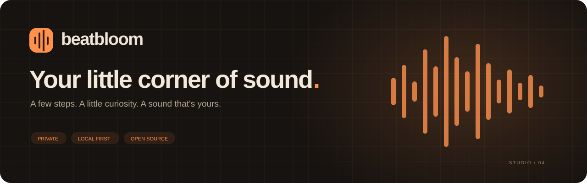
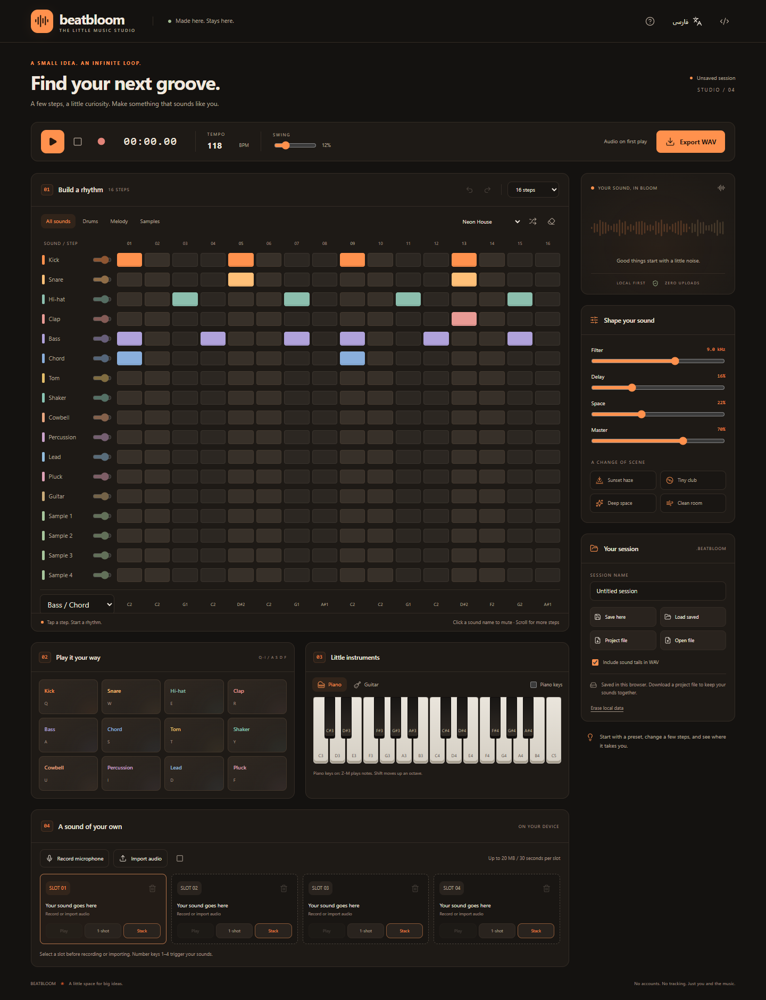

<div align="center">



**A private, playful music studio. Right in your browser.**

[](https://github.com/maboox/BeatBloom/actions/workflows/ci.yml)
[](https://github.com/maboox/BeatBloom/actions/workflows/codeql.yml)
[](LICENSE)
[](README-fa.md)

### [▶ Open the studio](https://maboox.github.io/BeatBloom/) · [↓ Releases](https://github.com/maboox/BeatBloom/releases) · [راهنمای فارسی](README-fa.md)

No accounts. No tracking. No audio uploads.

</div>



BeatBloom is a small browser music studio for quick ideas: sketch a rhythm, play a melody, record your voice, and take the loop with you. Synthesized instruments and imported samples run through one shared Web Audio engine for live playback and WAV rendering.

## Make your first loop

1. [Open BeatBloom](https://maboox.github.io/BeatBloom/) in a recent browser.
2. Choose a groove and press **Play**. Tap a few steps to change it.
3. Play the pads, piano or guitar. **Record into pattern** adds hits to the audible step.
4. Select a sample slot, then record your microphone or import a sound.
5. **Export WAV** for audio, or **Project file** for an editable backup including all four samples.

Use the **فارسی** button to switch to the Persian interface. Microphone access requires HTTPS or localhost and browser permission.

## A little studio, a lot to play with

| Create                                 | Shape                             | Keep                                              |
| -------------------------------------- | --------------------------------- | ------------------------------------------------- |
| 17 lanes; 8 / 16 / 24 / 32 steps       | Per-lane mute and volume          | Save/load in this browser                         |
| 10 ready-to-edit grooves               | Filter, delay, reverb and master  | Portable `.beatbloom` projects with audio         |
| 12 performance pads                    | Adjustable tempo and swing        | Stereo 44.1 kHz / 16-bit WAV                      |
| Two-octave piano and six-string guitar | Four one-shot / loop sample slots | Optional audio tails, or exact-length loop export |
| Live pattern recording; undo / redo    | Stack or Mono sample triggering   | English and Persian; responsive layout            |

Sample limits: **20 MB, 30 seconds, mono or stereo per slot**. Codec support depends on your browser. Existing v1–3.1 JSON arrangements can be imported; their audio uses this browser's existing slots because legacy JSON files did not contain audio.

### Keyboard shortcuts

| Action                      | Shortcut                                              |
| --------------------------- | ----------------------------------------------------- |
| Play / pause                | `Space` outside input controls and buttons            |
| Drums and percussion        | `Q W E R T Y U I`                                     |
| Bass / Chord / Lead / Pluck | `A S D F`                                             |
| Piano mode                  | Enable **Piano keys**, then `Z S X D C V G B H N J M` |
| Higher piano octave         | `Shift` + piano keys                                  |
| Sample slots                | `1 2 3 4`                                             |
| Undo / redo                 | `Ctrl/⌘ Z` / `Ctrl/⌘ Shift Z`                         |
| Save locally                | `Ctrl/⌘ S`                                            |

Piano mode replaces the pad shortcuts so one keystroke plays one instrument. The note selector under the sequencer edits Bass/Chord, Lead, Pluck or Guitar. Live piano recording preserves the played pitch. Shortening a loop keeps the hidden steps for later expansion. Presets replace step patterns and tempo; **Undo** recovers the previous arrangement.

## Your sounds stay with you

- Processing happens on your device. The app has no backend, analytics, external fonts or runtime CDN dependencies.
- **Save here** stores the arrangement in localStorage. Sample blobs use IndexedDB on the same origin and browser profile. Slots are shared by locally saved arrangements.
- **Project file** includes sample audio. Keep a backup before clearing site data, moving hosts, or replacing samples. Only share a project with people you want to hear its recordings.
- **Erase local data** removes the saved arrangement and sample blobs. The current step pattern remains in memory until the page closes.
- Microphone tracks stop when recording ends, fails, reaches its limit, or the page becomes hidden. Playback also stops on hidden tabs.

The public GitHub Pages host receives normal page and asset requests. The application does not send it your recordings or project contents. Browser extensions and your device remain outside the app's control. See [SECURITY.md](SECURITY.md).

## Run and develop locally

Use **Node.js 24 LTS** (minimum 22.13) and npm.

```sh
git clone https://github.com/maboox/BeatBloom.git
cd BeatBloom
npm ci --ignore-scripts
npm run dev
```

Open the localhost address printed in the terminal. Windows users can run `run-local.bat`; macOS/Linux users can run `sh run-local.sh` after installing dependencies.

```sh
npm run check                 # lint, formatting, unit tests, production build
npx playwright install chromium
npm run test:e2e              # browser, accessibility, import and audio regression tests
npm run test:production       # built artifact, CSP, export and license smoke test
npm run preview              # preview the production build
```

If a compatible browser is already installed, use `PLAYWRIGHT_CHANNEL=msedge` or `chrome` for local tests. In PowerShell, set `$env:PLAYWRIGHT_CHANNEL='msedge'` first. The public CI uses Playwright's bundled Chromium.

## Build and publish

`npm run build` creates **`dist/`** with relative asset paths, license notices and no runtime package installation. Serve that folder on any static HTTPS host. Opening the source `index.html` with `file://` is not supported: this version uses JavaScript modules and a build step.

GitHub Actions validates each main-branch change before the Pages workflow publishes it. Actions are pinned to reviewed commit hashes; Dependabot proposes updates. Pages must use **GitHub Actions** as its source. `_headers` supplies extra security headers on hosts that support that format; GitHub Pages ignores that file, so the app also includes a restrictive CSP meta tag.

## How it is organized

```text
src/
  model.js       Known-key project validation, migrations, presets, musical timing
  audio.js       Shared live/offline synthesis, effects, voice lifecycle, transport
  storage.js     IndexedDB and local project persistence
  wav.js         Stereo PCM WAV encoding
  main.js        UI, keyboard routing, recording and portable project files
  i18n.js        English/Persian strings and direction
  style.css      Responsive studio interface
  tokens.css     Warm orange design tokens
tests/           Model, WAV, browser, accessibility and security regressions
.github/         CI, CodeQL, Pages, dependency updates and contribution templates
docs/            Real screenshots, architecture and release notes
```

More about timing, storage and tradeoffs: [Architecture](docs/ARCHITECTURE.md). Contributions: [CONTRIBUTING.md](CONTRIBUTING.md). Bugs: [report an issue](https://github.com/maboox/BeatBloom/issues/new/choose). Security concerns: [report privately](https://github.com/maboox/BeatBloom/security/advisories/new).

## Scope and compatibility

BeatBloom is a sketchpad, not a full multitrack DAW. Pattern recording captures quantized hits, not a continuous performance. WAV export renders one selected loop with optional tails; manual sample loops become sequenced one-shots in exports. Undo covers arrangement edits, not deleted or replaced audio. Portable files can be large because they contain the original audio.

Current Chrome and Edge are the primary tested browsers. Firefox and Safari implement the required APIs, but codec support and microphone behavior vary; test your target browser before relying on a recording session. Touch, keyboard navigation and reduced-motion preferences are supported. Clearing browser storage removes local work unless you have downloaded a backup.

## License and credits

[MIT](LICENSE) © 2026 Maboox. Runtime libraries: [Lucide](https://lucide.dev) for consistent icons and [idb](https://github.com/jakearchibald/idb) for reliable IndexedDB transactions. Their licenses are included in [THIRD_PARTY_NOTICES.txt](THIRD_PARTY_NOTICES.txt) and the production build. All built-in instrument sounds are synthesized; no third-party sample recordings are shipped.
